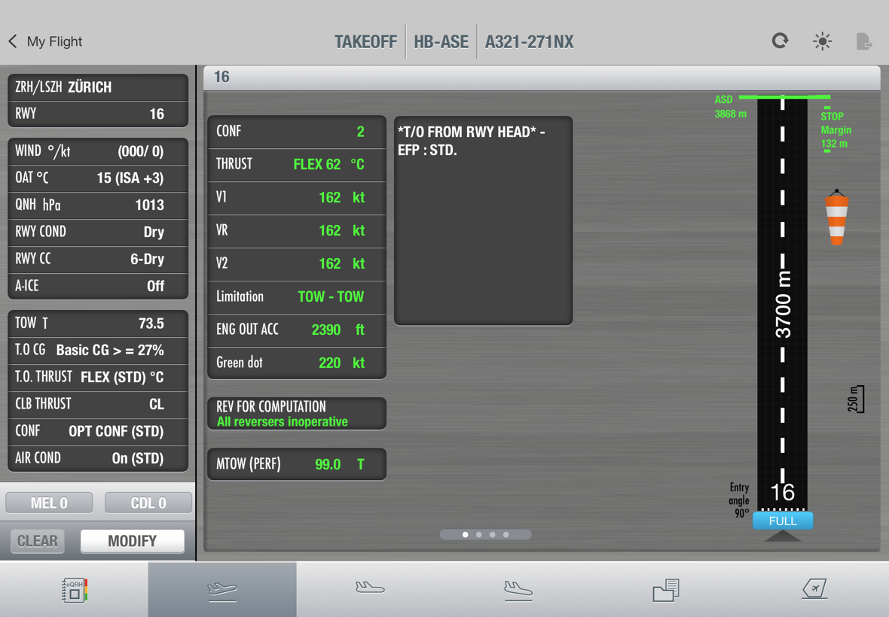

# EFB Design

Basic design guidelines for building iPad EFB apps **in the Flysmart look**: brushed metal,
glossy keys, dark data cards, colour that means something, one popover per field, a deliberate
COMPUTE. Follow these rules and any performance module (takeoff, landing, in-flight, weight and
balance) will look and behave like it belongs to that family.

The guidelines come with machine-readable tokens and a SwiftUI kit. Every value was measured from a
working reference implementation, a **TakeOff** performance module.



## Which apps follow this

| Module | Purpose |
| --- | --- |
| **TakeOff** (reference) | Takeoff performance: speeds, FLEX, CONF, limitations |
| Landing | Landing distance, autobrake, reverser credit |
| In-Flight Perf | Cruise, diversion, engine-out drift-down |
| Loadsheet (W&B) | Weight and balance |

All modules share the same shell (My Flight home, top bar, module bar) and the same rules.
Apps with a different job (moving maps, charts, rosters, document readers) are not part of this
family and keep their own look.

## The ten rules (short version)

1. **One fixed canvas.** Design on 1180 × 820 pt, landscape iPad, scaled to fit. Nothing reflows,
   no Dynamic Type.
2. **Colour is data state.** Blue = entered by the pilot, yellow = preselected by the system,
   green = computed, white = default or static, orange pencil = still required. Never decorative.
3. **Inputs left, answer right.** A fixed 260 pt input column, a result pane beside it.
4. **One field, one popover.** Every field opens its own panel anchored to the row with an arrow.
   No system keyboard, no sheets.
5. **Compute is a deliberate act.** COMPUTE stays dimmed until every field is set; a short
   "Computation is running" dialog; then the inputs lock until MODIFY.
6. **Defaults are visible.** A standard value carries `(STD)` and is shown in white, not blue.
7. **Forgiving entry, strict range.** Accept the units a pilot types (°F, inHg, lb, T, m/s) and
   convert; state format and range in the popover; refuse anything outside it.
8. **Materials have a job.** Metal is the stage, dark cards hold data, glossy keys are the only
   things that look pressable.
9. **Two typefaces, two roles.** Futura Condensed for labels, Helvetica Neue Condensed Bold for
   values. Monospace only for the FMS mirror.
10. **Speak cockpit, in English.** Uppercase abbreviations as on the flight deck (RWY, OAT, QNH,
    TOW), units in captions, no em dash.

The long version with the reasoning behind each rule: [docs/01-principles.md](docs/01-principles.md).

## Contents

| Doc | What it covers |
| --- | --- |
| [01 Principles](docs/01-principles.md) | The rules above, with reasons and do / don't |
| [02 Colour](docs/02-colour.md) | Palette, semantic roles, state colours |
| [03 Typography](docs/03-typography.md) | Fonts, sizes, casing, number formatting |
| [04 Layout](docs/04-layout.md) | Canvas, screen regions, grid, metrics |
| [05 Components](docs/05-components.md) | Cards, rows, buttons, popovers, keypad, overlays, result pages |
| [06 Interaction](docs/06-interaction.md) | Field lifecycle, compute flow, validation, navigation |
| [07 Content](docs/07-content.md) | Copy rules, labels, hints, units |
| [08 Branding and iconography](docs/08-brand-iconography.md) | Where the operator brand goes, icons, what never to use |
| [09 New app checklist](docs/09-new-app-checklist.md) | What a new module has to pass before release |
| [tokens/tokens.json](tokens/tokens.json) | All tokens, machine readable |

## Swift package: `EFBKit`

The tokens and core components as a SwiftUI package (iOS 17+), lifted from the reference app.

```swift
// Package.swift of the app
.package(url: "git@github.com:chrisfischer-lgtm/efb-design.git", branch: "main")
// target
.product(name: "EFBKit", package: "efb-design")
```

```swift
import EFBKit

EFBCanvas {                               // fixed 1180×820 pt, scaled to the device
    ZStack(alignment: .topLeading) {
        Metal()
        EFBCard {
            InputRow(label: "OAT", caption: "°C", state: .entered("12"), kind: .numeric)
            InputRow(label: "RWY COND", state: .missing, kind: .list)
            InputRow(label: "CONF", state: .standard("OPT CONF (STD)"), kind: .list)
        }
        .at(10, 98, w: 240)
    }
}
```

`FS` is kept as an alias of `EFB` (and `FSCard` of `EFBCard`), so code written against the
reference app compiles against the package unchanged.

## Legal note

"Flysmart" names the visual style these guidelines describe; it is a product name of its owner and
is used here only to describe that style. This repo contains no third-party artwork, logos,
screenshots, fonts or data: every colour and metric is our own measurement of our own
implementation, and all drawings are our own.
Keep it that way (see [08 Branding and iconography](docs/08-brand-iconography.md)).

Not for real-world flight operations.

All rights reserved.
