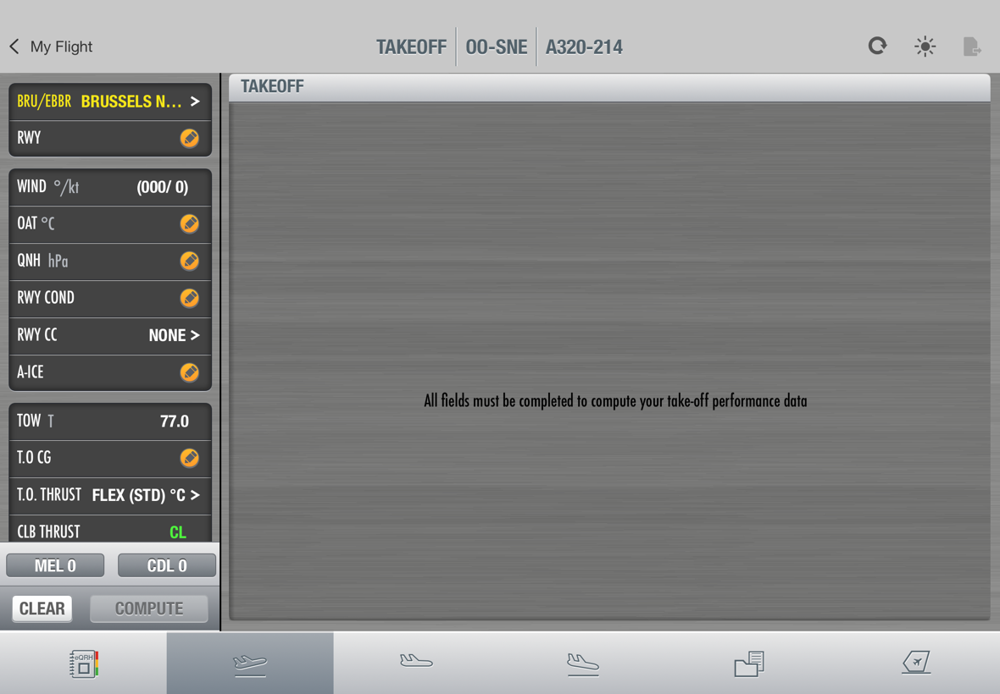
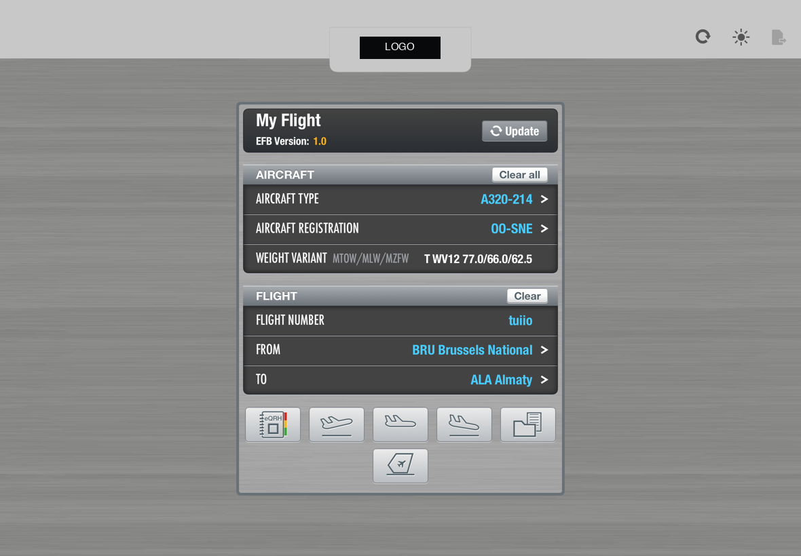
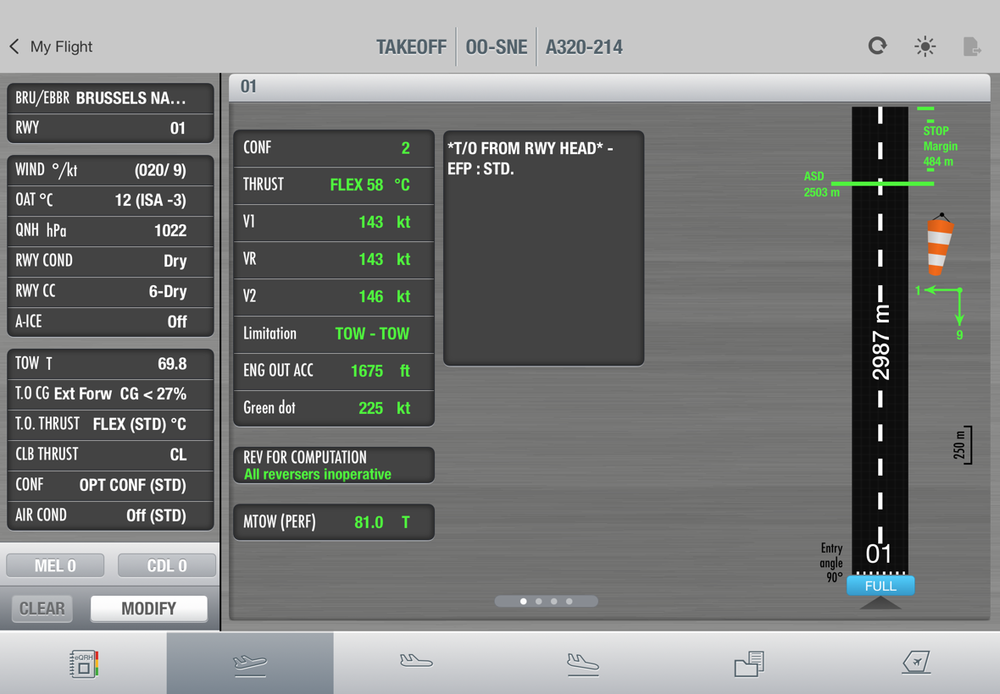

# 04 Layout

## Canvas

- **1180 × 820 pt**, landscape, origin top-left.
- Scaled uniformly: `scale = min(screenW / 1180, screenH / 820)`, centred, the remainder filled with
  `surface.chrome`.
- `EFBCanvas` in the kit does this. Ignore safe areas and the keyboard; hide persistent system
  overlays.

## Work screen regions

| Region | x | y | w | h | Notes |
| --- | --- | --- | --- | --- | --- |
| Top bar | 0 | 0 | 1180 | 86 | `surface.chrome`; back link left, title centre, tools right |
| Input column | 0 | 86 | 260 | 554 | Scrollable until locked; cards inset 10, gap 14 |
| Divider | 259 | 86 | 2 | 660 | Black |
| Result pane | 270 | 87 | 899 | 646.5 | Header band + pages + page dots |
| MEL / CDL strip | 0 | 641 | 259 | 51 | Two grey buttons 116 × 28 |
| Action strip | 0 | 693 | 259 | 52 | CLEAR 72 × 32 at x 13.5, COMPUTE 139.5 × 32 at x 106 |
| Module bar | 0 | 746 | 1180 | 74 | Equal-width tabs, selected tab darker |

### Top bar

- Back link: chevron 10.5 × 17 + label, at (11, 42).
- Title: `MODULE ┊ REGISTRATION ┊ TYPE`, centred around x 590, baseline band y 39.5, separated by a
  2 pt etched divider (`#6F7B82` + white 70 %), 46 pt tall.
- Tools at the right, 52 pt apart: refresh (1027), dim (1079.5), export (1136).

## Home screen (My Flight)

- Logo tab centred at the top edge (operator wordmark on black, silver tab).
- Central panel 484 × 581 at (348, 150), inner metal 476 × 573.
- Header card (My Flight + EFB version + Update), then **AIRCRAFT** and **FLIGHT** sections, each
  with a 33 pt glossy section header with a small action on the right (Clear all / Clear).
- Module buttons below in a grid (glossy squares, 81 × 51), second row centred.

## Metrics

| Token | Value | Used for |
| --- | --- | --- |
| `row.height` | 44 | Input and list rows (incl. 2 pt separator) |
| `row.heightCompact` | 36 | Input rows after COMPUTE (locked) |
| `row.paddingLeading` | 10 | Label inset inside a card |
| `row.paddingTrailing` | 16 list, 27 numeric, 15 pencil, 32 locked | Value inset, keeps values aligned whether a chevron is shown or not |
| `card.radius` | 8 | Data cards |
| `card.gap` | 14 | Between cards in a column |
| `card.inset` | 10 | Column edge to card |
| `popover.width` | 419 | All field popovers |
| `popover.radius` | 4 | Popover panel |
| `popover.arrow` | 13 × 24 | Left arrow, centred on the row (clamped 16 pt from the panel ends) |
| `popover.x` | 262 | Popovers open right of the input column |
| `popover.yRange` | 32.5 … 733 | Panel is clamped vertically inside this band |
| `button.radius` | 5 (bars), 4 (popover), 3 (small) | Gloss buttons |
| `key.size` | 59 × 58 (digits), 60 × 58 (function) | Keypad |
| `key.radius` | 6 | Keypad keys |
| `pencil.size` | 23 | Required-input badge |
| `checkmark.size` | 18 × 17 | Selected list entry |
| `chevron.size` | 9 × 11 | List disclosure |

## Result pane

- Header band 32 pt with the runway ident.
- Pages are 899 × 612.5; page dots in a capsule at the bottom centre.
- Result cards are 238 pt wide at x 5; a note box 237.5 pt wide next to them.
- The runway strip lives at x 660 on every page that needs it, so it does not jump while swiping.

## Layering

From bottom to top: metal → cards → strips → module bar → **tap catcher** (`black 0.1 %`, full
canvas, dismisses) → popover → modal panel (graph) → dim layer → computing overlay (`black 28 %`
backdrop, dialog centred 20 pt above the middle).
