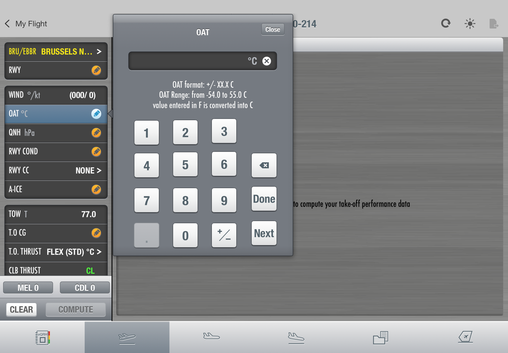
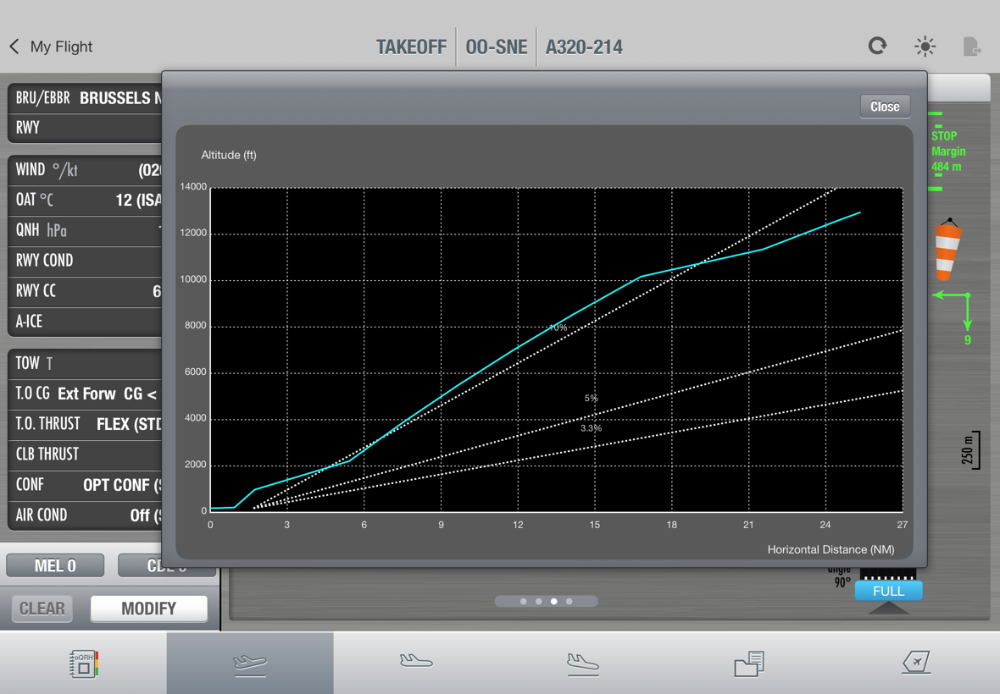

# 05 Components

Every component below exists in the reference TakeOff app and, where marked **kit**, in `EFBKit`.

## Surfaces

### Metal (kit: `Metal`)
Procedural horizontal brushed texture tiled over a base colour: random low-frequency bands
(6 to 40 pt, ±3.5 % white/black) plus 0.5 pt streaks (60 to 320 pt long, ±4.5 %). Generated once,
seeded, seamless. Use `surface.metalLight` for screens, `metalDark` for the result pane.

### Card (kit: `EFBCard`)
Dark rounded rectangle (`surface.card`, radius 8) with:
- a blurred inner shadow (black 42 %, 6 pt line, 3 pt blur) for the recessed look,
- a 1 pt `cardEdge` outline,
- a 1 pt light bevel (`#B6B9BF`) offset 1 pt below.

Holds rows. Never put loose text on metal.

### Row (kit: `fsRow`, `InputRow`)
44 pt (36 compact), full card width. Etched separator on top (1 pt `cardEdge` + 1 pt
`separatorLight`), except the first row. Label left in Futura, value right in Helvetica Condensed
Bold. The trailing element tells the input type:

| Trailing | Meaning |
| --- | --- |
| Orange **pencil badge** | Required, empty |
| Value + **chevron** `>` | Pick from a list |
| Value, no chevron | Numeric / free entry (keypad) |
| Green value, no affordance | Fixed by type, not editable |
| Nothing after lock | Result computed, inputs frozen |

While its popover is open the row background becomes the **row selected** gradient and the pencil
turns light blue.

## Buttons (kit: `GlossButton`)

Three-stop vertical gradient, 1 pt border, a 1 pt white 55 % highlight under the bottom edge, embossed
label.

| Style | Use |
| --- | --- |
| `.white` | Primary: COMPUTE, MODIFY, CLEAR, Done, Clear all, STOP |
| `.whiteDimmed` | Primary but not available (COMPUTE before all fields are set) |
| `.grey` | Secondary: MEL, CDL, Close, Update, Restore, Modify RWY |
| `.greyDimmed` | Secondary while locked |

Dimmed buttons stay visible in place. Never hide a primary action, show that it is unavailable.

## Popovers

### Panel (kit: `PopoverPanel`)
419 pt wide, radius 4, lit 20 pt title band in the gradient, outline `#282C32`, shadow black 45 %
radius 5 y 2. Left arrow pointing at the edited row.

### List popover (kit: `ListPopover`)
Title + Close (top right), 1 to 3 hint lines ("Select RWY COND setting from the list."), a card of
44 pt rows. Current value: blue check mark. Optional trailing text (`MAX`). Two header variants:
`.tall` (title y 41) and `.short` (title y 29.5) for short lists. Long lists scroll inside the card
with a visible row limit.

### Searchable list
Airport and registration lists add a search pill on top (capsule, magnifier, 17 pt). Rows show
`IATA  Name`.

### Keypad popover (kit: `NumpadPopover`)



Entry field (dark card, white value, grey unit, round clear button) at the top, hint lines with
format, range and accepted conversions, then the keypad:

```
 1   2   3   [*]      * only where a shortcut exists (TOW: structural)
 4   5   6   [⌫]
 7   8   9   [Done]
 .   0   ±   [Next]
```

`.` is disabled when a decimal already exists or the field is empty; `±` only where negative values
exist. The first key press replaces the pre-filled value. **Done** commits and closes, **Next**
commits and opens the next field.

### Composite popovers
Wind: segmented ABSOLUTE / RELATIVE, three chips (direction, speed, gust), HD/TL stepper.
Runway: list with `>` per runway plus footer buttons (Modify RWY, Modify All Engine Data) that push
sub-pages with a **Back** tag and Restore / Done.

## Feedback

### Computing overlay (kit: `ComputingOverlay`)
420 × 214 metal frame, dark inner panel with spinner and two lines
("Computation is running …", "Please wait"), white STOP button 200 × 44. Backdrop black 28 %.
Shown for about 3 s even if the solver is faster: the pause is part of the ritual and prevents
double taps.

### Info alert
Modules or functions that are not built yet answer with a system alert titled with the app name:
"This module is not available in this version."

### Note box (kit: `NoteBox`)
Card with free text, Helvetica Condensed Bold 20, top-left aligned. For operational notes
(`*T/O FROM RWY HEAD* - EFP : STD.`).

### Page dots (kit: `PageDots`)
Grey capsule, 7.5 pt dots 10.5 pt apart, current white.

## Result pages

1. **Summary**: one card of green result rows (CONF, THRUST, V1, VR, V2, Limitation, ENG OUT ACC,
   Green dot), reverser note card, MTOW (PERF) card, note box, runway strip.
2. **FMS mirror**: black display in the MCDU layout and palette.
3. **Climb**: settings rows + gradient table + GRAPH button opening a modal chart.
4. **Min / Max**: limits table.

Rule: page 1 answers the question in one look; every further page is a cross-check.

### Runway strip
Vertical black runway with centreline dashes, length label rotated, 250 m scale bar, threshold ident,
entry angle, blue `FULL` / intersection tag, windsock with green head/cross wind arrows, and after
COMPUTE the green ASD line and STOP margin. Drawn to scale.

### Graph modal



905 × 588.5 panel, inner `#595959` radius 15, black plot with dotted grid, cyan path, dotted white
reference gradients, Close top right.

## Module bar (app specific, not in the kit)

74 pt, equal tabs, idle gradient light, selected tab darker with a 2 pt top highlight. Icons are line
drawings in `#555555`. Tabs open sibling apps by URL scheme (eQRH, cruise / navigation,
documents).
